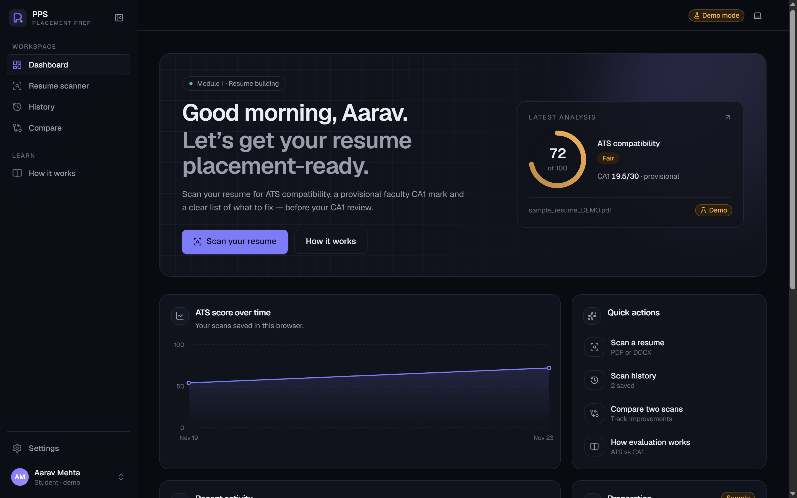
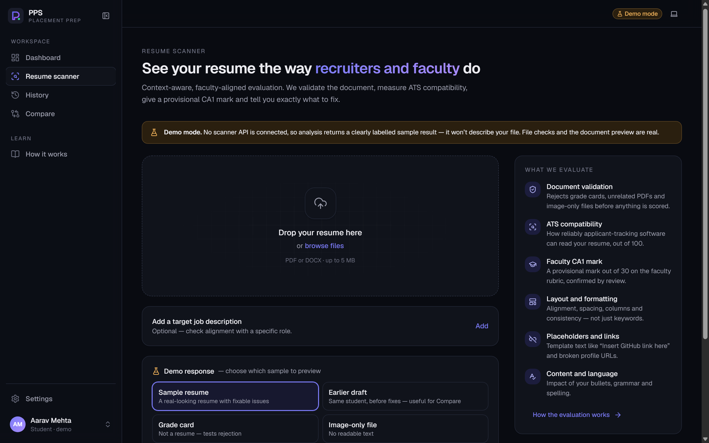
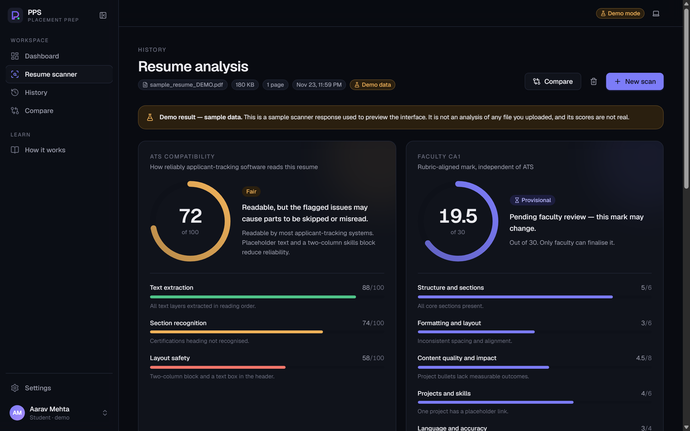
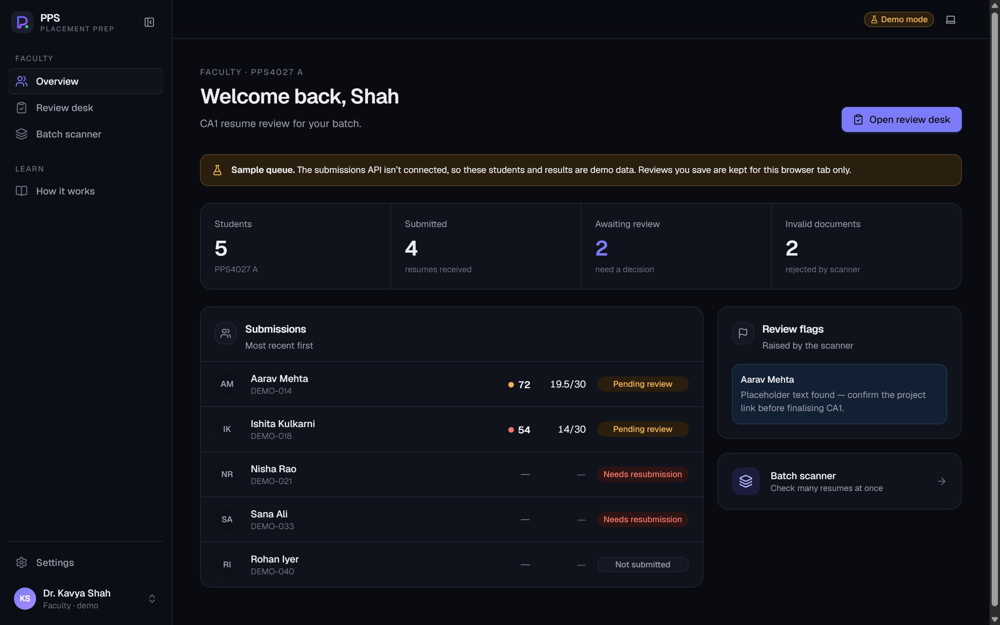
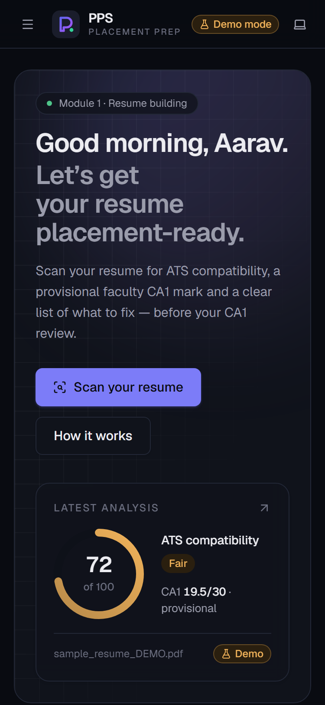
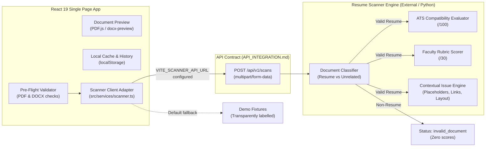
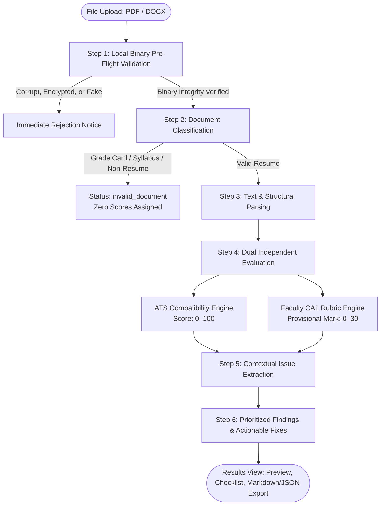

# PPS Resume Checker

> **Context-Aware Resume Analysis & Faculty-Aligned Evaluation**

[](https://react.dev/)
[](https://www.typescriptlang.org/)
[](https://vite.dev/)
[](https://tailwindcss.com/)
[](https://vitest.dev/)
[](https://www.python.org/)

**PPS Resume Checker** is a specialized, context-aware resume analysis and evaluation platform built for campus placement preparation. Unlike traditional keyword-stuffing ATS scanners, PPS evaluates structural integrity, document validity, and academic alignment—providing separate, transparent assessments for corporate **Applicant Tracking System (ATS) compatibility** (`/100`) and institutional **Faculty Continuous Assessment (CA1)** marks (`/30`).

---

## Project Overview

### The Motivation: Lessons from 120 Student Resumes
Campus placement training frequently relies on generic online resume scanners or rigid keyword checkers. During empirical evaluation of approximately **120 student resumes**, critical failure modes were identified in standard automated tools:

1. **Accepting Non-Resume Documents**: Grade cards, course transcripts, syllabus sheets, and assignment briefs were routinely accepted and awarded passing scores simply because they contained words like "Computer Science" or "Database".
2. **Missing Incomplete & Placeholder Content**: Submissions with placeholder text—such as *"Insert GitHub link here"* or dummy URLs like `linkedin.com/in/`—were erroneously scored as having complete contact and project links.
3. **Overlooking Critical Formatting Flaws**: Two-column skill layouts (which cause parsers to scramble content horizontally), tab-stop misalignments, and inconsistent section spacing were ignored by standard keyword checkers.
4. **Conflating Academic Grading with Industry Parsing**: Earlier systems conflated faculty rubric marks with industry ATS scores (e.g., displaying a 76/100 ATS score as an academic CA1 mark).

### The Context-Aware Solution
PPS Resume Checker was architected to address these exact shortcomings:
* **Binary Pre-Flight & Classification**: Validates file integrity (PDF magic bytes, EOF markers, encryption, DOCX packages) and performs document classification. Non-resumes are rejected with **zero scores** to prevent false reassurance.
* **Independent Dual Scoring**: Keeps recruiter ATS compatibility (`/100`) strictly decoupled from academic CA1 marks (`/30`).
* **Contextual Issue Detection**: Flags placeholder links, missing quantified project metrics, multi-column parsing traps, and grammar/tense inconsistencies.
* **Evidence-Based Feedback**: Connects every finding to the exact detected text, explains *why it matters* to recruiters, and offers an actionable fix.

---

## Application Preview

The application features a production-ready React 19 interface designed for both students and faculty reviewers.

### 1. Student Dashboard & Trends
*Overview of placement preparation progress, latest resume scores, ATS score trajectories, and quick actions.*



---

### 2. Resume Upload & Pre-Flight Validation
*Drag-and-drop upload supporting PDF and DOCX formats with real-time binary verification and optional Target Job Description (JD) matching.*



---

### 3. Dual-Scoring Analysis View
*Decoupled evaluation presenting the ATS Compatibility Score (/100) alongside the provisional Faculty CA1 Placement Mark (/30).*


---

### 4. Categorized Findings & Actionable Feedback
*Severity-prioritized findings explorer (Critical, Warnings, Suggestions, Strengths) with detected text evidence and recommended corrections.*



---

### 5. Faculty Review Desk & Rubric Overrides
*Faculty interface for evaluating student cohorts, reviewing scanner flags, overriding academic rubrics, and submitting formal approval decisions.*



---

### 6. Mobile Responsive Interface
*Fully responsive viewport design (tested at 375 px) ensuring clean mobile accessibility without layout overflow.*

<p align="center">
  
</p>

---

## Features Matrix

We maintain transparency regarding implemented features, demo mockups, and planned integrations:

| Category | Capability | Status | Description |
| :--- | :--- | :---: | :--- |
| **Pre-Flight** | Binary Verification | 🟢 Real | Validates `%PDF-` magic bytes, EOF tags, encryption flags, and DOCX ZIP XML trees. |
| **Pre-Flight** | Size & File Guard | 🟢 Real | Enforces strict 5 MB file size limit and prevents non-document uploads. |
| **Preview** | PDF Document Viewer | 🟢 Real | In-browser canvas rendering with zoom, page navigation, and download via `react-pdf` / `PDF.js`. |
| **Preview** | DOCX Document Viewer | 🟢 Real | In-browser approximate layout preview powered by `docx-preview`. |
| **Evaluation** | Dual Independent Scores | 🟢 Real UI / 🟡 Demo | Circular SVG rings for ATS (`/100`) and CA1 (`/30`) with strict range enforcement. |
| **Evaluation** | Document Rejection | 🟢 Real | Grade cards and non-resumes receive zero scores with clear rejection diagnostics. |
| **Evaluation** | Contextual Findings | 🟢 Real UI / 🟡 Demo | Categorized analysis for Links, Formatting, Structure, Impact, and Contact info. |
| **Workspace** | History & Compare | 🟢 Real | Persisted in `localStorage`; compare any two revisions with score deltas and resolved findings. |
| **Workspace** | Export Engine | 🟢 Real | Client-side generation of Markdown summaries (`.md`) and raw JSON payloads (`.json`). |
| **Faculty** | Review & Rubrics | 🟡 Demo | Searchable submission queue, interactive CA1 rubric adjustment, and session approvals. |
| **Faculty** | Batch Analysis | 🟢 Real UI / 🟡 Demo | Multi-file dropzone with per-file validation, progress indicators, and CSV export. |
| **Backend** | REST API Integration | 🔵 Live-Ready | Connects immediately when `VITE_SCANNER_API_URL` is set to a conforming scanner engine. |

> Detailed technical specifications are available in [docs/FEATURES.md](docs/FEATURES.md).

---

## Technology Stack

### Frontend Application (`PPS_APP/frontend/`)
* **Core Framework**: [React 19](https://react.dev/) + [TypeScript](https://www.typescriptlang.org/) (strict mode)
* **Build System**: [Vite 8](https://vite.dev/)
* **Styling & Design System**: [Tailwind CSS 4](https://tailwindcss.com/) with semantic CSS tokens, [Geist & Geist Mono](https://vercel.com/font) typography
* **UI Components**: [Radix UI](https://www.radix-ui.com/) accessible primitives (Dialog, Tabs, Dropdowns, Tooltips)
* **Animations**: [Motion](https://motion.dev/) (hardware accelerated, reduced-motion aware)
* **Icons & Visuals**: [Lucide React](https://lucide.dev/)
* **Data Visualization**: [Recharts](https://recharts.org/)
* **Document Rendering**: [react-pdf](https://github.com/wojtekmaj/react-pdf) (PDF.js) and [docx-preview](https://github.com/VolodymyrBaydalka/docxjs)
* **Notifications**: [Sonner](https://sonner.emilkowal.ski/)
* **Routing**: [React Router 7](https://reactrouter.com/)
* **Testing & Quality**: [Vitest](https://vitest.dev/), [Testing Library](https://testing-library.com/), [ESLint](https://eslint.org/)

### Legacy Prototype & Backend Modules (`PPS_APP/`)
* **Python Runtime**: Python 3.12+ / 3.14 compatible
* **Prototype UI**: [Streamlit 1.64](https://streamlit.io/) (`streamlit_app.py`)
* **Data Handling**: [pandas](https://pandas.pydata.org/)
* **Code Quality**: [Ruff](https://docs.astral.sh/ruff/) and [pytest](https://docs.pytest.org/)

---

## System Architecture



> For deep architectural details and data flow sequences, refer to [docs/ARCHITECTURE.md](docs/ARCHITECTURE.md).

---

## Project Structure

```text
PPS_resume_APP/
├── .gitignore                      # Git exclusion rules (node_modules, venvs, cache)
├── README.md                       # Root repository documentation (this file)
├── docs/                           # Architecture specs, feature matrices & assets
│   ├── ARCHITECTURE.md             # System architecture & sequence diagrams
│   ├── FEATURES.md                 # Complete real vs demo capability audit
│   └── screenshots/                # Real application preview screenshots
│       ├── dashboard.png
│       ├── resume-upload.png
│       ├── ats-results.png
│       ├── feedback.png
│       ├── faculty-dashboard.png
│       └── mobile-view.png
└── PPS_APP/                        # Core application root
    ├── API_INTEGRATION.md          # REST API schema contract for scanner backends
    ├── FRONTEND_AUDIT.md           # Engineering audit of the Streamlit prototype
    ├── FRONTEND_FEATURES.md        # Technical notes on the React migration
    ├── pyproject.toml              # Python linting and pytest configuration
    ├── requirements.txt            # Python dependencies (Streamlit, pandas)
    ├── streamlit_app.py            # Legacy Streamlit prototype entry point
    ├── app_pages/                  # Legacy Streamlit page scripts
    ├── services/                   # Python data models & mock services
    ├── tests/                      # Python pytest test suites
    └── frontend/                   # Primary React + TypeScript application
        ├── index.html
        ├── package.json
        ├── vite.config.ts
        ├── src/
        │   ├── App.tsx             # Route definitions & application shell
        │   ├── components/         # Modular UI & ATS result components
        │   ├── data/               # Strictly typed demo fixtures
        │   ├── lib/                # Client-side validation, store, and utilities
        │   ├── pages/              # Application routes (Student & Faculty)
        │   ├── services/           # HTTP scanner client and faculty adapters
        │   ├── styles/             # Tailwind 4 theme tokens & CSS variables
        │   ├── test/               # Vitest test suites
        │   └── types/              # TypeScript scan contracts & data models
        └── public/                 # Static assets and icons
```

---

## Getting Started

### Prerequisites
* **Node.js**: Version 20.0 or higher (`node -v`)
* **npm**: Version 10.0 or higher (`npm -v`)
* **Python**: Version 3.12+ (optional, only needed if executing the legacy Streamlit prototype)

---

### Running the Primary React Application

Open **Windows PowerShell** and follow these steps:

1. **Clone the repository**:
   ```powershell
   git clone https://github.com/hemanth16-cmd/PPS_Resume_Checker.git
   cd PPS_Resume_Checker
   ```

2. **Navigate to the frontend workspace**:
   ```powershell
   cd PPS_APP\frontend
   ```

3. **Install dependencies**:
   ```powershell
   npm install
   ```

4. **Start the local development server**:
   ```powershell
   npm run dev
   ```

5. **Open the application**:
   Navigate to [http://localhost:5173](http://localhost:5173) in your web browser.
   * Toggle between the **Student** and **Faculty** roles using the account menu in the lower-left navigation bar.

---

### Connecting an External Scanner Backend
The frontend operates in **Demo mode** out of the box. To connect a live evaluation engine:

1. Create a local environment file in `PPS_APP/frontend/`:
   ```powershell
   Copy-Item .env.example .env.local
   ```
2. Set your scanner API endpoint in `PPS_APP/frontend/.env.local`:
   ```env
   VITE_SCANNER_API_URL=https://your-scanner-service.edu
   VITE_SCANNER_API_KEY=your_optional_api_token
   ```
3. Restart the dev server (`npm run dev`). The UI badge will automatically transition from `Demo mode` to `Live scanner`.

---

### Running the Legacy Streamlit Prototype (Optional)

If you wish to explore the earlier Python prototype:

1. Navigate to the `PPS_APP` directory:
   ```powershell
   cd PPS_APP
   ```
2. Create and activate a Python virtual environment:
   ```powershell
   python -m venv .venv
   .\.venv\Scripts\Activate.ps1
   ```
3. Install Python requirements:
   ```powershell
   pip install -r requirements.txt
   ```
4. Run the Streamlit application:
   ```powershell
   python -m streamlit run streamlit_app.py
   ```

---

## How the ATS Evaluation Works



1. **Pre-Flight Binary Verification**: The browser inspects raw file buffers to reject corrupted packages, password locks, or renamed non-PDF files before processing.
2. **Document Classification**: The engine verifies whether the content represents an authentic resume. Non-resumes are flagged with `invalid_document` and receive **no scores**.
3. **Decoupled Evaluation**:
   * **ATS Score (`/100`)**: Evaluates section readability, font compatibility, column structure, and standard heading recognition.
   * **CA1 Mark (`/30`)**: Grades the document against academic rubrics (Structure, Layout, Impact, Projects, Language).
4. **Contextual Analysis**: Detects placeholder text (`Insert GitHub link here`), unquantified achievements, inconsistent date alignment, and grammatical inconsistencies.
5. **Interactive Resolution**: Students can mark findings as resolved, download annotated reports, or compare drafts side by side.

---

## Verification & Testing

Every layer of the frontend application is tested and verified:

```powershell
cd PPS_APP\frontend

# Run Vitest test suite
npm test

# Run TypeScript type verification
npm run typecheck

# Run ESLint linter
npm run lint

# Execute production build
npm run build
```

### Verified Test Results
* **Unit & Component Tests**: `26 passed` (file validators, schema parsers, score range guards, error mappers, comparison logic, exports).
* **TypeScript Compilation**: Clean zero-error pass with strict types enabled (`tsc -b --noEmit`).
* **Linter**: Clean zero-warning pass (`eslint .`).
* **Production Build**: Clean bundle generated in `1.53s` (`vite build`).

---

## Roadmap

- [x] High-performance React 19 + TypeScript single-page application.
- [x] Client-side binary pre-flight file validation (PDF & DOCX).
- [x] Decoupled dual scoring (ATS /100 vs CA1 /30) with range guards.
- [x] In-browser document preview (PDF.js & docx-preview).
- [x] Scan history, multi-scan comparison, and trend analytics.
- [x] Faculty review desk and batch upload interface.
- [ ] Connect Python NLP / LLM resume evaluation engine via `POST /api/v1/scans`.
- [ ] Implement backend database persistence for user scans and faculty reviews.
- [ ] Add student authentication and institutional Single Sign-On (SSO).
- [ ] Support on-page PDF visual bounding box annotations (`location.region`).

---

## Authors & Acknowledgments

* **Lead Developer & Maintainer**: [Hemanth](https://github.com/hemanth16-cmd)
* **Project**: Developed as part of the **PPS Automated Placement Preparation System** to enhance campus placement readiness.
