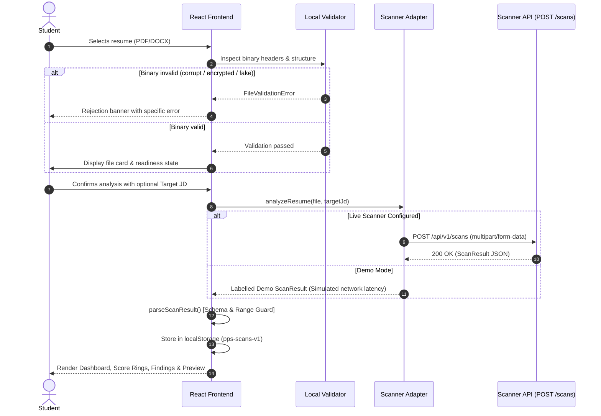

# System Architecture & Technical Design

This document details the software architecture, component relationships, data contracts, and evaluation pipelines of the **PPS Resume Checker** platform.

---

## 1. High-Level Architecture Overview

The system is designed with a clean separation of concerns between client-side user experience, pre-flight file validation, state management, and the downstream resume evaluation service.

```mermaid
graph TD
    subgraph Clients ["User Interfaces"]
        Student["Student User"]
        Faculty["Faculty / Reviewer"]
    end

    subgraph FrontendSPA ["React 19 Frontend SPA (Vite)"]
        UI["UI Layer (Tailwind CSS 4 + Radix Primitives)"]
        Preflight["Local Pre-Flight File Validator<br/>(PDF magic bytes, Corrupt DOCX, Size checks)"]
        DocViewer["In-Browser Document Viewer<br/>(PDF.js + docx-preview)"]
        Store["Client Store & Session Cache<br/>(localStorage + in-memory)"]
        ClientAdapter["Scanner Service Adapter<br/>(src/services/scanner.ts)"]
    end

    subgraph BackendGateway ["API Contract Layer (API_INTEGRATION.md)"]
        ScannerAPI["POST /api/v1/scans (multipart/form-data)"]
        FacultyAPI["GET /api/v1/submissions (Planned)"]
    end

    subgraph Engine ["Python Resume Evaluation Engine (External / Planned)"]
        DocClassifier["Document Type Classifier<br/>(Detects resumes vs grade cards/transcripts)"]
        ATSScorer["ATS Compatibility Engine (/100)<br/>(Text extractability, headings, formatting)"]
        CA1Engine["Faculty CA1 Evaluation Engine (/30)<br/>(Academic rubrics & criteria breakdown)"]
        ContextChecker["Contextual Issue & Placeholder Detector<br/>(Detects 'Insert link here', broken URLs, spacing)"]
    end

    subgraph DemoMode ["Demo Mode Fallback (Current State)"]
        MockFixtures["Strictly Typed Demo Fixtures<br/>(valid_resume, earlier_draft, grade_card, empty_document)"]
    end

    Student -->|Uploads PDF / DOCX| UI
    Faculty -->|Reviews & Overrides Rubric| UI
    UI --> Preflight
    UI --> DocViewer
    UI --> Store
    UI --> ClientAdapter

    ClientAdapter -->|If VITE_SCANNER_API_URL is set| ScannerAPI
    ClientAdapter -->|Default (No API URL set)| MockFixtures

    ScannerAPI --> DocClassifier
    DocClassifier -->|If valid resume| ATSScorer
    DocClassifier -->|If valid resume| CA1Engine
    DocClassifier -->|If valid resume| ContextChecker
    DocClassifier -->|If non-resume| Reject["Reject with 'invalid_document'"]
```

---

## 2. Architectural Principles

### A. Decoupled Dual Scoring (ATS /100 vs CA1 /30)
One of the primary findings from evaluating ~120 student resumes during campus placement preparation was that traditional systems erroneously equate recruiter ATS suitability with faculty academic marks.
* **ATS Compatibility Score (`0–100`)**: Evaluates mechanical parseability, section heading detection, text extractability, single-column alignment, and standard layout compatibility for corporate applicant tracking systems.
* **CA1 Faculty Mark (`0–30`)**: Assesses placement training academic performance against a standardized rubric (Structure, Layout, Content & Impact, Projects, Language & Accuracy).
* **Strict Independence**: The frontend parser (`src/lib/parse.ts`) strictly enforces that ATS and CA1 remain independent. CA1 marks are never derived from ATS scores, and scores outside valid numerical boundaries are rejected.

### B. Pre-Flight Client-Side Validation
Before sending any file across the network, the client executes rigorous binary-level validation:
1. **File Size**: Rejection of files exceeding 5 MB.
2. **PDF Integrity**: Validates the `%PDF-` header signature, checks for EOF markers, and catches password-encrypted or truncated documents.
3. **DOCX Structure**: Validates ZIP container headers (`PK\x03\x04`), verifies `[Content_Types].xml`, and checks word processing relationship XML to detect corrupted or renamed archives.

### C. Zero-Deception Document Classification
Traditional keyword scanners often award high scores to non-resume files (e.g., academic grade cards or assignment briefs) simply because they contain keywords like "Computer Science" or "Algorithms".
* The PPS pipeline mandates **Document Classification** as Step 1.
* If a document is classified as `grade_card`, `unrelated`, `empty`, or `unreadable`, the status transitions to `invalid_document`.
* **Zero Score Presentation**: Invalid documents receive **no ATS or CA1 score**, preventing students from receiving false positive validation.

---

## 3. Data Flow & Evaluation Sequence



---

## 4. API Contract Schema

The complete contract between any backend evaluation service and the frontend is specified in `API_INTEGRATION.md` and enforced in TypeScript (`src/types/scan.ts`):

```typescript
export interface ScanResult {
  scan_id: string;
  status: "completed" | "invalid_document" | "failed";
  analysed_at: string;
  file: {
    name: string;
    mime_type: string;
    size_bytes: number;
    pages?: number;
  };
  validation: {
    is_resume: boolean;
    document_type: "resume" | "grade_card" | "unrelated" | "empty" | "unreadable" | "unsupported";
    message: string;
    reasons: string[];
    confidence?: number;
  };
  // Present only when status === "completed" and validation.is_resume === true
  ats?: {
    score: number; // 0–100
    summary: string;
    components: Array<{
      name: string;
      score: number;
      max_score: number;
      summary: string;
    }>;
  };
  ca1?: {
    total: number; // 0–30
    max_score: number;
    status: "provisional" | "faculty_reviewed";
    rubric: Array<{
      criterion: string;
      score: number;
      max_score: number;
      comment?: string;
    }>;
    reviewed_by?: string | null;
    reviewed_at?: string | null;
  };
  categories: Array<{
    key: string;
    label: string;
    status: "pass" | "warn" | "fail" | "info";
    summary: string;
    score?: number | null;
    max_score?: number | null;
  }>;
  findings: Array<{
    id: string;
    title: string;
    category: string;
    severity: "critical" | "warning" | "suggestion" | "info";
    explanation: string;
    why_it_matters: string;
    suggestion: string;
    evidence?: string | null;
    location?: {
      page?: number;
      section?: string;
      region?: { x: number; y: number; width: number; height: number };
    };
    resolved?: boolean;
  }>;
  sections_detected: string[];
  review_flags: Array<{ code: string; message: string }>;
  reports: Array<{ kind: string; label: string; url: string; available: boolean }>;
  error?: string | null;
}
```

---

## 5. Security & Privacy Considerations

1. **Client-Side Data Retention**: All scan records, user session states, and review overrides are stored strictly in client `localStorage` and browser memory. No private student documents are cached on external cloud servers unless an explicit backend endpoint is configured.
2. **Safe Exporting**: Feedback summaries (.md) and raw payloads (.json) are generated entirely client-side using JavaScript `Blob` objects.
3. **Demo Transparency**: Any demo-generated report includes explicit `source: "demo"` metadata and visual disclaimer banners to eliminate misrepresentation during academic evaluations.
